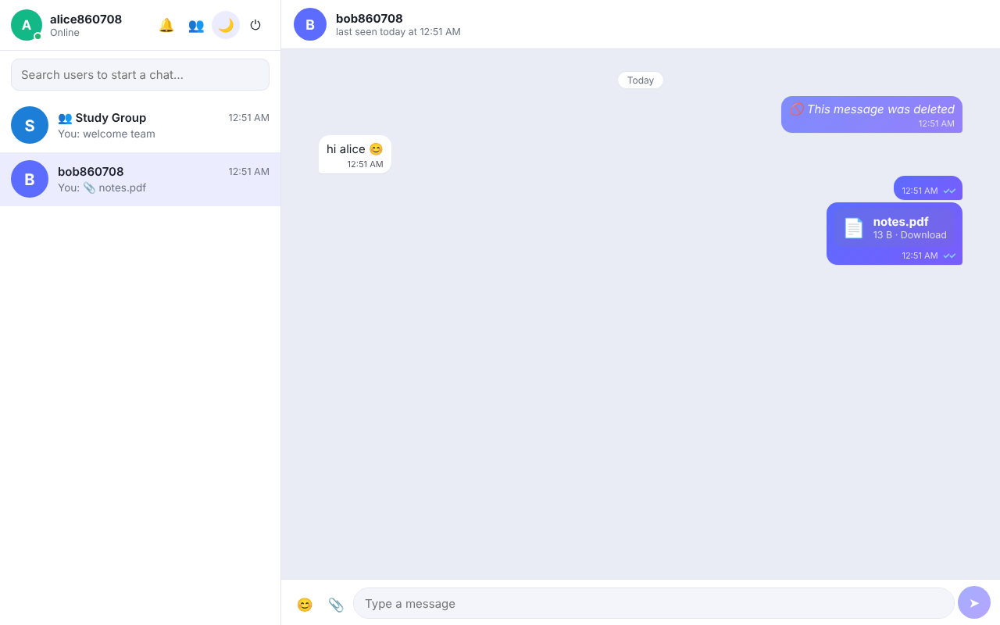
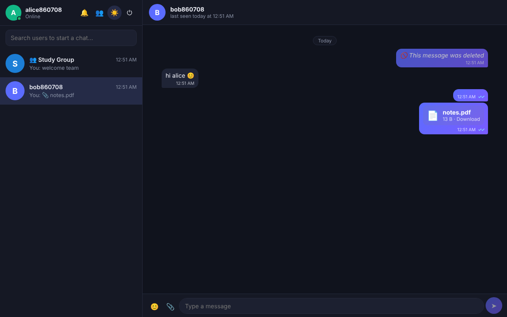
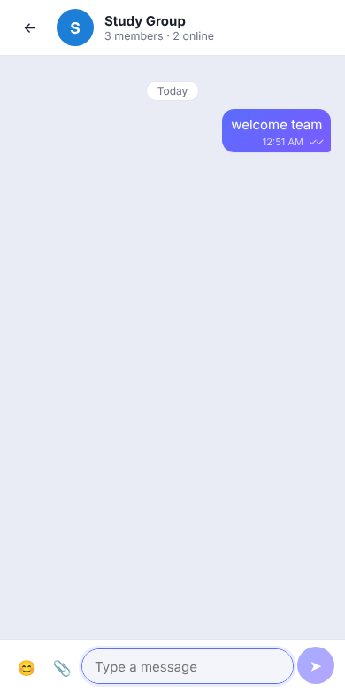

# 🚀 ConnectX – Real-Time Chat Application

A modern full-stack messaging platform with private and group chats, live typing indicators, online status, file sharing and read receipts.



<p>
  
  
</p>

## ✨ Features

| Area | What it does |
|---|---|
| **Authentication** | Register, login, logout, JWT sessions, bcrypt password hashing, profile (username + photo) |
| **Messaging** | Instant 1-to-1 and group chat, timestamps, typing indicators, delivery status (✓ sent, ✓✓ delivered, blue ✓✓ read) |
| **Online status** | Online/offline dots, "last seen", live member count in groups |
| **Files** | Send images (shown inline) and documents (download card), 10 MB limit, safe-type allowlist |
| **Extras** | User search, create groups, edit & delete messages, emoji picker, dark/light mode, unread counters, desktop notifications, fully responsive |

## 🧱 Tech stack

React 18 + Vite · React Router · plain CSS (CSS variables) · Node.js · Express · PostgreSQL (`pg`) · Socket.IO · JWT · bcrypt · multer · Helmet

## 📁 Project structure

```
ConnectX/
├── client/                    React app (Vite)
│   └── src/
│       ├── components/        Sidebar, ChatWindow, MessageBubble, MessageInput, modals…
│       ├── pages/             Login, Register, Chat
│       ├── context/           AuthContext, ThemeContext, ChatContext (socket + chat state)
│       ├── hooks/             useChat
│       ├── services/          api.js (REST), socket.js
│       └── utils/             date / size formatting
├── server/
│   ├── config/                db.js (pool), initDb.js
│   ├── controllers/           auth, user, conversation, message, upload
│   ├── middleware/            auth (JWT), upload (multer)
│   ├── models/                all SQL lives here
│   ├── routes/
│   ├── sockets/               index (auth + rooms + presence), messageHandlers, presence
│   ├── tests/                 end-to-end API + socket test
│   └── server.js
├── database/schema.sql        6 tables
└── docs/screenshots/
```

## ⚙️ Run it locally

You need **Node.js 18+** and **PostgreSQL 14+**.

```bash
# 1. install everything
npm run install:all

# 2. create the database
psql -U postgres -c "CREATE DATABASE connectx;"

# 3. configure the server
cp server/.env.example server/.env      # then edit DATABASE_URL and JWT_SECRET

# 4. create the tables
npm run db:init

# 5. start server (port 5000) + client (port 5173)
npm run dev
```

Open <http://localhost:5173>, register two accounts in two different browsers (or one normal + one private window) and start chatting.

Run the automated API/socket test (server must be running): `npm test --prefix server`

## 🔌 REST API

| Method | Endpoint | Description |
|---|---|---|
| POST | `/api/auth/register` | Create account → `{ token, user }` |
| POST | `/api/auth/login` | Log in → `{ token, user }` |
| GET / PUT | `/api/users/me` | Get / update my profile |
| GET | `/api/users?q=` | Search users by username |
| GET | `/api/conversations` | My chats (last message, unread count, members) |
| POST | `/api/conversations/direct` | Open or create a 1-to-1 chat `{ userId }` |
| POST | `/api/conversations/group` | Create a group `{ name, memberIds }` |
| GET | `/api/conversations/:id/messages?before=&limit=` | Message history (cursor pagination) |
| POST | `/api/upload` | Upload a file (multipart `file`) |

All endpoints except register/login need `Authorization: Bearer <token>`.

## 📡 Socket.IO events

| Direction | Event | Payload |
|---|---|---|
| client → server | `message:send` | `{ conversationId, body, attachment }` (with ack) |
| client → server | `message:edit` / `message:delete` | `{ id, body }` / `{ id }` |
| client → server | `typing` | `{ conversationId, isTyping }` |
| client → server | `conversation:read` | `{ conversationId }` |
| server → client | `message:new` / `message:updated` | message object |
| server → client | `message:status` | `{ conversationId, statuses: [{ id, status }] }` |
| server → client | `typing` | `{ conversationId, userId, username, isTyping }` |
| server → client | `presence:list` / `presence:update` | online ids / `{ userId, online, last_seen }` |
| server → client | `conversation:new` | conversation object |

The JWT is sent once in the connection handshake (`auth: { token }`) and verified before the socket is accepted.

## 🔒 Security notes

- Passwords hashed with bcrypt; login errors never reveal whether an email exists
- Rate limiting on login/register and on socket messages
- Server always uses the user id from the verified token, never one sent by the client
- Membership is checked before reading history, sending, or typing
- Uploads: extension allowlist, random file names, `nosniff` header; avatar/attachment URLs must point to our own `/uploads/`
- Helmet security headers, CORS limited to `CLIENT_URL`

## 👥 Our Team

| Contributor | Role | GitHub |
|---|---|---|
| Deepak Gupta | Frontend Developer | [@USERNAME](https://github.com/USERNAME) |
| Member 2 | Backend Developer | [@USERNAME](https://github.com/USERNAME) |
| Member 3 | Database Developer | [@USERNAME](https://github.com/USERNAME) |
| Member 4 | Real-Time Developer | [@USERNAME](https://github.com/USERNAME) |

## 📊 GitHub Contributors


> Replace `USERNAME` with your GitHub username and the member names/links above.

## ☁️ Deployment (short version)

1. **Database + API → Render** (or Railway): create a PostgreSQL instance and a Web Service from `server/`. Start command `npm start`. Set `DATABASE_URL`, `JWT_SECRET`, `CLIENT_URL` (your frontend URL), and run `npm run db:init` once from the service shell.
2. **Frontend → Vercel / Netlify**: root directory `client/`, build command `npm run build`, output `dist`, env var `VITE_API_URL=https://your-api.onrender.com`.
3. Uploaded files are stored on the server disk, which free hosts reset on redeploy; for permanent storage switch `middleware/upload.js` to Cloudinary or S3.

See [TEAM_GUIDE.md](TEAM_GUIDE.md) for the team workflow.
